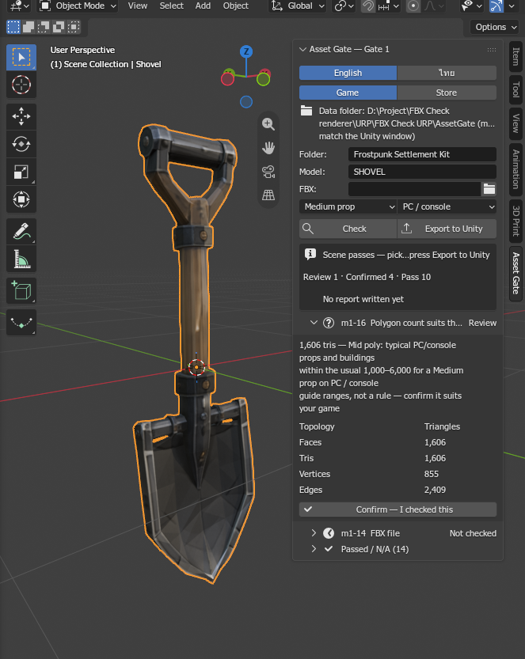
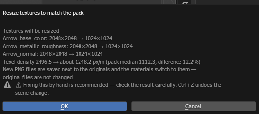
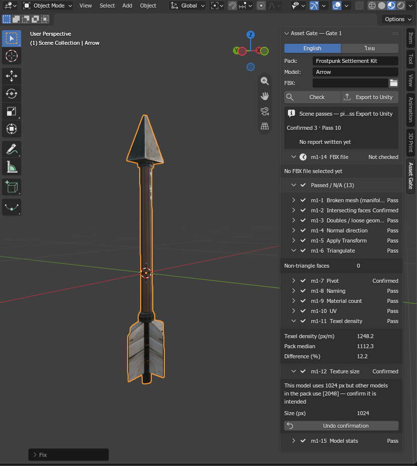

# คู่มือ Asset Gate (ภาษาไทย)

[English](MANUAL.en.md) · [README](../README.th.md)

Asset Gate ช่วยตรวจโมเดล 3 มิติก่อนเอาไปใช้ในเกม ทั้งโมเดลที่ปั้นเองและโมเดลที่สร้างด้วย AI ตรวจเป็น 3 ด่าน:

| ด่าน | ตรวจที่ | ตรวจอะไร |
|---|---|---|
| ด่าน 1 | Blender | เมช, UV, เท็กซ์เจอร์, ชื่อ, จุดหมุน, ไฟล์ FBX ก่อนส่งเข้า Unity |
| ด่าน 2 | Unity | ค่าการนำเข้า, แมทีเรียล URP, prefab, กล่องชน, ฉากทดสอบ |
| ด่าน 3 | Unity + หน้าเว็บ | ทั้งแพ็กพร้อมขายบน Unity Asset Store หรือยัง (เฉพาะโหมดทำขาย) |

---

## สารบัญ

1. [เลือกโหมดให้ตรงกับงาน](#1-เลือกโหมดให้ตรงกับงาน)
2. [ติดตั้ง](#2-ติดตั้ง)
3. [ตั้งค่าครั้งแรก](#3-ตั้งค่าครั้งแรก)
4. [ขั้นตอนการทำงานตั้งแต่ต้นจนจบ](#4-ขั้นตอนการทำงานตั้งแต่ต้นจนจบ)
5. [แผง Asset Gate ใน Blender](#5-แผง-asset-gate-ใน-blender)
6. [หน้าต่าง Asset Gate ใน Unity](#6-หน้าต่าง-asset-gate-ใน-unity)
7. [หน้าเว็บ (ด่าน 3)](#7-หน้าเว็บ-ด่าน-3)
8. [ข้อตรวจทุกข้อ: คืออะไร และแก้ยังไง](#8-ข้อตรวจทุกข้อ-คืออะไร-และแก้ยังไง)
9. [กฎตายตัว กับ คำแนะนำที่กดยืนยันได้](#9-กฎตายตัว-กับ-คำแนะนำที่กดยืนยันได้)
10. [ปุ่มแก้อัตโนมัติ](#10-ปุ่มแก้อัตโนมัติ)
11. [โฟลเดอร์ข้อมูลและไฟล์ที่ระบบสร้าง](#11-โฟลเดอร์ข้อมูลและไฟล์ที่ระบบสร้าง)
12. [ปัญหาที่พบบ่อย](#12-ปัญหาที่พบบ่อย)

---

## 1. เลือกโหมดให้ตรงกับงาน

| โหมด | เหมาะกับใคร | ใช้ด่านไหน |
|---|---|---|
| **ใช้ในเกม (Game)** — ค่าเริ่มต้น | ทำหรือเจนโมเดลมาใช้ในเกมของตัวเอง | ด่าน 1 + 2 ไม่ต้องเปิดหน้าเว็บ |
| **ทำขาย (Store)** | ทำแพ็ก asset ขายบน Unity Asset Store | ด่าน 1 + 2 + 3 และใช้หน้าเว็บรวมผลทั้งแพ็ก |

เลือกได้ทั้งในแผง Blender และในหน้าต่าง Unity (ตั้งให้ตรงกันทั้งสองโปรแกรม) · ในโหมดใช้ในเกม ข้อที่เป็นเรื่องการขาย (m4-1…m4-4) จะขึ้นว่า "ไม่เกี่ยวข้อง" และปุ่มตรวจทั้งแพ็ก (ด่าน 3) จะถูกปิดไว้

---

## 2. ติดตั้ง

### สิ่งที่ต้องมี
- **Blender 4.2 ขึ้นไป** (ทดสอบแล้วกับ 4.5 และ 5.2)
- **Unity 6 (6000.0) ขึ้นไป** กับโปรเจกต์ที่ใช้ **URP** (ทดสอบแล้วกับ 6000.3 และ 6000.5)
- **Chrome หรือ Edge** สำหรับหน้าเว็บ (เฉพาะโหมดทำขาย)

### Blender add-on
1. ดาวน์โหลด `asset_gate-<เวอร์ชัน>.zip` จากหน้า Releases ของ repo
2. Blender → **Edit > Preferences > Get Extensions** → ปุ่มลูกศรมุมขวาบน → **Install from Disk…** → เลือกไฟล์ zip
3. เปิด 3D Viewport กด **N** → แท็บ **Asset Gate**

> เคยติดตั้งรุ่นก่อน 1.0 (ไฟล์ `asset_gate.zip` แบบ add-on เดิม)? ให้ลบรุ่นเก่าออกก่อนใน **Preferences > Add-ons** แล้วปิด-เปิด Blender ใหม่ ค่าที่ตั้งไว้ (โปรเจกต์ Unity, โฟลเดอร์ข้อมูล) ต้องตั้งใหม่

### Unity package
1. เปิดโปรเจกต์ Unity (URP)
2. **Window > Package Manager** → ปุ่ม **+** → **Install package from git URL…**
3. ใส่ `https://github.com/b2cm92ts5k-alt/AssetGate.git?path=/unity/com.etlolz.assetgate` แล้วกด Install
   - ถ้าไม่มี git ในเครื่อง: ดาวน์โหลด repo เป็น zip แล้วใช้ **Install package from disk…** เลือกไฟล์ `unity/com.etlolz.assetgate/package.json`
4. เปิดหน้าต่างที่ **Tools > Asset Gate > Open Window**

### หน้าเว็บ (เฉพาะโหมดทำขาย)
เปิดไฟล์ `web/index.html` ด้วย Chrome หรือ Edge (ดาวน์โหลดจาก repo ได้เลย ไม่ต้องติดตั้งอะไร)

---

## 3. ตั้งค่าครั้งแรก

ทั้ง 3 ส่วนคุยกันผ่าน **โฟลเดอร์ข้อมูล (Data folder)** ซึ่งเก็บผลตรวจทุกชิ้น · ปกติอยู่ใน **`<โปรเจกต์ Unity>/AssetGate`** (นอกโฟลเดอร์ `Assets` จึงไม่ถูก Unity นำเข้า)

| ที่ | ต้องตั้งอะไร |
|---|---|
| Blender | เลือก **โปรเจกต์ Unity** ครั้งเดียว (ช่องนี้จะขึ้นในแผงเองถ้ายังไม่ได้เลือก หรือตั้งใน Preferences > Add-ons > Asset Gate) |
| Unity | ไม่ต้องตั้ง — ใช้ `<โปรเจกต์นี้>/AssetGate` เอง |
| หน้าเว็บ | กด **เลือกโฟลเดอร์ข้อมูล** แล้วเลือก `<โปรเจกต์ Unity>/AssetGate` |

**ค่าใน Preferences > Add-ons > Asset Gate (Blender)**

| ช่อง | ใช้ทำอะไร |
|---|---|
| ภาษา | ภาษาของแผงและข้อความผลตรวจ (English / ไทย) |
| ใช้งาน | ใช้ในเกม / ทำขาย |
| Unity project | โฟลเดอร์โปรเจกต์ Unity ที่ปุ่ม "ส่งเข้า Unity" จะส่งไฟล์ไปให้ (โฟลเดอร์ที่มี `Assets` อยู่ข้างใน) |
| Data folder (optional) | **ไม่ต้องใส่** ถ้าใช้ค่าปกติ · ใส่เฉพาะเมื่ออยากเก็บผลไว้ที่อื่น — ถ้าใส่ ต้องตั้งที่เดียวกันในหน้าต่าง Unity ด้วย (ปุ่ม เลือก…) |

> แผง Blender แสดงบรรทัด **"โฟลเดอร์ข้อมูล: …"** ไว้เสมอ ต้องตรงกับบรรทัด **โฟลเดอร์ข้อมูล** ในหน้าต่าง Unity ถ้าไม่ตรง Unity จะหาผลจาก Blender ไม่เจอ (Unity บอกสาเหตุนี้ให้เอง)

---

## 4. ขั้นตอนการทำงานตั้งแต่ต้นจนจบ

1. **Blender** — เปิดไฟล์โมเดล ใส่ชื่อ **โฟลเดอร์** (ชื่อแพ็ก) และ **โมเดล** แล้วกด **ตรวจ**
2. แก้ข้อที่ไม่ผ่าน (ใช้ปุ่มแก้อัตโนมัติ หรือแก้เอง) และกด **ยืนยัน** ข้อที่รอยืนยันหลังดูด้วยตา
3. กด **ส่งเข้า Unity** — ระบบตรวจอีกรอบ ถ้าไม่มีข้อไม่ผ่านจะส่ง FBX + เท็กซ์เจอร์ไปที่ `Assets/<โฟลเดอร์>/Meshes` และ `Assets/<โฟลเดอร์>/Textures` (สร้างโฟลเดอร์ให้เอง)
4. **Unity** — สลับไปที่ Unity รอนำเข้าไฟล์ เลือกไฟล์ FBX ใน `Assets/<โฟลเดอร์>/Meshes` แล้วกด **ตั้งค่าอัตโนมัติ** (ค่าการนำเข้า + แมทีเรียล + prefab) แล้วกด **ตรวจ**
5. แก้ข้อที่ไม่ผ่าน และกดยืนยันข้อที่รอยืนยัน
6. **(โหมดทำขาย)** ตรวจทุกโมเดลในแพ็กแบบเดียวกัน → คลิกขวาโฟลเดอร์แพ็ก **Asset Gate > Check Pack** → เปิดหน้าเว็บดูด่าน 3 ทั้งแพ็ก

แก้โมเดลหลังส่งไปแล้ว? กด **ส่งเข้า Unity** อีกครั้งได้เลย (ระบบถามก่อนทับไฟล์) แล้วกด **ตั้งค่าอัตโนมัติ** และ **ตรวจ** ใน Unity ใหม่

---

## 5. แผง Asset Gate ใน Blender



### ส่วนบน — ตั้งค่า

| ส่วน | คำอธิบาย |
|---|---|
| English / ไทย | ภาษา — สลับแล้วระบบตรวจใหม่ให้เอง ผลที่แสดงจะเป็นภาษาใหม่ทันที |
| ใช้ในเกม / ทำขาย | โหมด (ดู [ข้อ 1](#1-เลือกโหมดให้ตรงกับงาน)) |
| โฟลเดอร์ข้อมูล: … | ที่เก็บผลตรวจ — ต้องตรงกับหน้าต่าง Unity |
| โฟลเดอร์ (โหมดใช้ในเกม) / แพ็ก (โหมดทำขาย) | ชื่อโฟลเดอร์ใน `Assets/` ที่จะส่งไฟล์ไป เช่น `Frostpunk Settlement Kit` → `Assets/Frostpunk Settlement Kit/Meshes/…` · **ระบบสร้างโฟลเดอร์ให้เองตอนส่งเข้า Unity** |
| โมเดล | ชื่อโมเดล = ชื่อไฟล์ FBX ใน Unity · เว้นว่างได้ (ใช้ชื่อไฟล์ FBX หรือชื่อไฟล์ .blend แทน) |
| FBX | **ตรวจครั้งแรกไม่ต้องใส่** — ข้อ m1-14 จะขึ้น "ยังไม่ตรวจ" ซึ่งปกติ · กด "ส่งเข้า Unity" แล้วระบบใส่ path ของไฟล์ใน Unity ให้เอง · **ส่งใหม่ไม่ต้องลบช่องนี้** · ใส่เองเมื่ออยากตรวจไฟล์ FBX ที่ export เอง |
| ประเภทโมเดล / แพลตฟอร์ม | ไม่บังคับ — ใช้ให้คำแนะนำจำนวนโพลีกอน (m1-16) ตรงกับงานมากขึ้น · บันทึกไว้ในไฟล์ .blend |
| **ตรวจ** | ตรวจด่าน 1 ในฉากที่เปิดอยู่ (ไม่แก้ฉาก ไม่บันทึกไฟล์) · ถ้ามีไฟล์ FBX ในช่อง จะตรวจไฟล์นั้นด้วยและบันทึกผลลงโฟลเดอร์ข้อมูล |
| **ส่งเข้า Unity** | ตรวจ → ถ้าไม่มีข้อไม่ผ่าน ส่ง FBX + เท็กซ์เจอร์ PNG เข้าโปรเจกต์ Unity และบันทึกผล · ต้องเปิดโปรเจกต์นั้นใน Unity อยู่ (เวอร์ชัน 6000.0 ขึ้นไป) · ถามก่อนทับไฟล์เดิม |

### ส่วนผลตรวจ

- **กล่องสรุป** — ผ่านด่าน 1 หรือยัง และนับจำนวน ไม่ผ่าน · รอยืนยัน · ยืนยันแล้ว · ผ่าน
- **ข้อตรวจแต่ละข้อ** พับ/กางได้ · ข้อที่ไม่ผ่านและรอยืนยันอยู่บนสุด · ข้อที่ผ่านแล้วพับรวมไว้ใน "ผ่านแล้ว / ไม่เกี่ยวข้อง"
- **ตัวเลขในแต่ละข้อ** — ตัวเลขที่เป็นปุ่ม (เช่น จำนวนหน้าที่ตัดกัน) กดแล้วเข้า Edit Mode และเลือกส่วนนั้นให้ดูทันที (เหมือน 3D-Print Toolbox) · ถ้าแก้เมชหลังตรวจ ต้องกดตรวจใหม่ก่อน
- **ปุ่มแก้อัตโนมัติ** — ปุ่มที่มีไอคอนเครื่องมือ = ปลอดภัย · ปุ่มที่มี ⚠ + "แนะนำให้แก้เอง" = มีความเสี่ยง · ทุกปุ่มขึ้นหน้าต่างบอกก่อนว่าจะเปลี่ยนอะไร (ดู [ข้อ 10](#10-ปุ่มแก้อัตโนมัติ))
- **ยืนยัน — ตรวจดูเองแล้ว / ยกเลิกการยืนยัน** — ใช้กับข้อที่รอยืนยัน · การยืนยันจะหายเองถ้ากดตรวจใหม่แล้วผลของข้อนั้นเปลี่ยน
- **วิธีแก้เอง** — ข้อที่ไม่มีปุ่มแก้อัตโนมัติจะบอกวิธีแก้ด้วยมือแทน
- **"ผลตรวจเก่าแล้วหลังย้อนกลับ"** — หลังกด Ctrl+Z / Ctrl+Shift+Z ปุ่มแก้และปุ่มยืนยันถูกซ่อน จนกว่าจะกดตรวจใหม่





---

## 6. หน้าต่าง Asset Gate ใน Unity

เปิดที่ **Tools > Asset Gate > Open Window** · หรือคลิกขวาไฟล์ใน Project window → **Asset Gate > Setup Model / Check Model / Check Pack**

| ส่วน | คำอธิบาย |
|---|---|
| ภาษา | English / ไทย — สลับแล้วตรวจใหม่ให้เอง |
| ใช้งาน | ใช้ในเกม / ทำขาย (ตั้งให้ตรงกับ Blender) |
| โฟลเดอร์ข้อมูล / เลือก… | ปกติไม่ต้องเลือก (ใช้ `<โปรเจกต์>/AssetGate`) · เลือกเองเมื่อ Blender ใช้โฟลเดอร์อื่น |
| **ตั้งค่าอัตโนมัติ** | เลือกไฟล์ FBX (หรือ prefab ของมัน) ใน `Assets/<แพ็ก>/Meshes` ก่อน แล้วกด: ตั้งค่าการนำเข้าโมเดลและเท็กซ์เจอร์, สร้างแมทีเรียล URP/Lit พร้อมใส่เท็กซ์เจอร์ถูกช่อง, แปลง metallic-roughness เป็น metallic-smoothness (ถ้ายังไม่ได้แปลงตอนส่ง), สร้าง prefab + กล่องชน (Box Collider) · กดซ้ำได้ (อัปเดตของเดิม) · แตะเฉพาะไฟล์ของโมเดลนั้น |
| **ตรวจ** | ตรวจด่าน 2 ของโมเดลที่เลือก (อ่านอย่างเดียว) · ถ่ายภาพหน้าจอมุมมาตรฐานเก็บในโฟลเดอร์ข้อมูล |
| **ตรวจทั้งแพ็ก** (โหมดทำขาย) | เลือกโฟลเดอร์แพ็กหรือไฟล์ในนั้น แล้วกด — ตรวจด่าน 3 ส่วนที่ทำใน Unity |
| **ล้างผล** | ล้างข้อความและผลที่แสดงอยู่ (เช่น หลังลบโมเดลออกจากโปรเจกต์) |

**ส่วนผลตรวจ**
- กล่องสรุป · ข้อที่ไม่ผ่านอยู่บน · ข้อที่ยืนยันแล้วแสดง "ยืนยันแล้ว"
- **กล่องจำนวนโพลีกอน** — จำนวนสามเหลี่ยมและจุดใน Unity พร้อมคำแนะนำเดียวกับ Blender (จำนวนจุดใน Unity มากกว่าใน Blender เป็นปกติ เพราะ Unity แยกจุดตามรอยต่อ UV และขอบคม) · ตอนตรวจทั้งแพ็กจะแสดงยอดรวมทั้งแพ็ก
- **ปุ่มแก้อัตโนมัติ** ใต้ข้อที่แก้ได้ · ข้อที่แก้ไม่ได้มีคำแนะนำ
- **ปุ่มยืนยัน / ยกเลิกการยืนยัน** ใต้ข้อที่รอยืนยัน
- **ที่มาของโมเดล (โหมดทำขาย)** — ช่อง "เครื่องมือ / แพลนที่ใช้สร้าง", "วันที่สร้าง", "สิ่งที่ปรับเองด้วยมือ" → กด **บันทึกแล้วตรวจใหม่** · ใช้กับข้อ m4-1…m4-4 และร่างข้อความเปิดเผยการใช้ AI ในหน้าเว็บ
- **เปิดภาพหน้าจอ** — เปิดภาพมุมมาตรฐานที่ถ่ายไว้

---

## 7. หน้าเว็บ (ด่าน 3)

ใช้เฉพาะโหมดทำขาย · เปิด `web/index.html` → **เลือกโฟลเดอร์ข้อมูล** → แพ็กและโมเดลขึ้นเองจากผลตรวจ (ไม่ต้องเพิ่มเอง) · หน้าเว็บอ่านผลใหม่ทุก 3 วินาที หรือกด **โหลดใหม่**

| ส่วน | คำอธิบาย |
|---|---|
| English / ไทย | ภาษาของหน้าเว็บ (ข้อความผลจาก Blender/Unity เป็นภาษาที่ใช้ตอนกดตรวจ) |
| แถบแพ็ก | เลือกแพ็ก · บอกจำนวนชิ้นที่ผ่านครบ |
| ข้อมูลแพ็ก | Unity เวอร์ชันที่ทดสอบ (ใช้ในร่างคำอธิบาย) · **งบสามเหลี่ยมสูงสุดต่อชิ้น** (Blender ใช้ค่านี้ในข้อ m1-15) · โน้ต |
| สรุปทั้งแพ็ก | ตารางทุกโมเดล: จำนวนสามเหลี่ยม, ขนาดเท็กซ์เจอร์, ด่าน 1, ด่าน 2, ความคืบหน้า, ข้อที่ยังค้างและต้องแก้ในโปรแกรมไหน |
| ร่างข้อความหน้าขาย (English) | **Technical details** จากตัวเลขจริง (k1-8) และ **AI disclosure** จากช่อง "สิ่งที่ปรับเองด้วยมือ" ใน Unity (k1-7) — กดคัดลอกไปวางในหน้าขาย แล้วแก้ให้ถูกต้อง |
| ภาพหน้าขาย | วางไฟล์ภาพใน `<โฟลเดอร์ข้อมูล>/marketing/<แพ็ก>/` ชื่อ `icon.png`, `card.png`, `cover.png`, `social.png`, `screenshot_01.png`… ระบบตรวจขนาดให้ (k2-1…k2-5) |
| ด่าน 3 (A / B / C) | ทุกข้อของแพ็ก · ข้อที่รอยืนยันกด **ยืนยัน** · ข้อที่ไม่ผ่านแต่ตั้งใจ กด **ยอมรับแม้ไม่ผ่าน…** แล้วใส่เหตุผล · ข้อที่เครื่องตัดสินไม่ได้ **ติ๊กเอง** |
| Export JSON / Import JSON | สำรองหรือย้ายข้อมูลที่กรอกในหน้าเว็บ (รองรับไฟล์จากเช็คลิสต์ v2) |

---

## 8. ข้อตรวจทุกข้อ: คืออะไร และแก้ยังไง

สัญลักษณ์: **กฎ** = ต้องผ่าน · **ยืนยันได้** = คำแนะนำ ดูแล้วกดยืนยันได้ถ้าเหมาะกับงานคุณ · 🔧 = มีปุ่มแก้อัตโนมัติ · ⚠🔧 = มีปุ่มแก้แต่มีความเสี่ยง แนะนำให้แก้เอง

### ด่าน 1 — Blender

#### m1-1 เมชเสีย (ไม่ปิดสนิท / ขนาดเป็นศูนย์) — กฎ
- **คืออะไร:** เส้นขอบที่ไม่ปิดสนิท (non-manifold เช่น รูโหว่ หรือหน้ามากกว่า 2 หน้าใช้ขอบเดียวกัน), เส้นขอบที่หน้าสองข้างหันสวนกัน, หน้าที่พื้นที่เป็นศูนย์ และเส้นขอบที่ยาวเป็นศูนย์ (นิยามเดียวกับ 3D-Print Toolbox) ทำให้แสงเงาเพี้ยน ชนผิด และ Unity คำนวณ tangent ผิด
- **ระบบดู:** นับแต่ละอย่าง ต้องเป็น 0 ทั้งหมด · เกณฑ์ขนาดศูนย์ = `mesh.degenerateThreshold` (0.0001 เมตร)
- **วิธีแก้เอง:** กดตัวเลขเพื่อเลือกส่วนที่เสีย → Edit Mode → Mesh > Clean Up > Degenerate Dissolve (ขนาดศูนย์) · อุดรูด้วย Fill (F) หรือ Grid Fill · หน้าหันสวน: Mesh > Normals > Recalculate Outside
- **ปุ่มแก้:** 🔧 ลบหน้า/เส้นขอบที่ขนาดเป็นศูนย์ · 🔧 ทำให้หน้าที่อยู่ติดกันหันทางเดียวกัน · ⚠🔧 อุดรู (อาจอุดรูที่ตั้งใจเปิดไว้)

#### m1-2 หน้าตัดทะลุกัน — ยืนยันได้
- **คืออะไร:** หน้าที่ทะลุกันในชิ้นเดียวกัน · ถ้าเป็นชิ้นส่วนที่ซ้อนกันโดยตั้งใจ (เช่น ด้ามเสียบหัวพลั่ว) ไม่เป็นไร · ถ้าเป็นเศษจาก AI หรือหน้าซ้อนซ้ำ จะเห็นกะพริบในเกม
- **ระบบดู:** นับหน้าที่ตัดกัน (0 = ผ่าน, มากกว่า 0 = รอยืนยัน)
- **วิธีแก้เอง:** กดตัวเลขเพื่อเลือกดู · ถ้าเป็นเศษ ลบทิ้ง · ถ้าตั้งใจ → **ยืนยัน**

#### m1-3 จุดซ้อนกัน / ชิ้นส่วนลอย — กฎ
- **คืออะไร:** จุดที่ซ้อนอยู่ตำแหน่งเดียวกัน (ทำให้เกิดรอยตะเข็บแสง) และจุด/เส้นขอบที่ลอยไม่มีหน้า (เปลืองและทำให้ bounds ผิด) · หน้าที่อยู่ข้างในเนื้อเป็นคำเตือนเท่านั้น
- **ระบบดู:** จุดที่ห่างกันน้อยกว่า `mesh.mergeDistance` (0.0001 เมตร), จุดลอย, เส้นขอบลอย ต้องเป็น 0
- **วิธีแก้เอง:** Edit Mode → เลือกทั้งหมด → Mesh > Merge > By Distance · Mesh > Clean Up > Delete Loose
- **ปุ่มแก้:** 🔧 รวมจุดซ้อน + ลบชิ้นส่วนลอย

#### m1-4 ทิศของหน้า (normal) — กฎ
- **คืออะไร:** หน้าที่หันเข้าด้านใน จะมองไม่เห็นหรือแสงกลับด้านใน Unity
- **ระบบดู:** เทียบกับทิศที่คำนวณใหม่ ต้องไม่มีหน้าหันเข้าใน
- **วิธีแก้เอง:** Edit Mode → เลือกทั้งหมด → Shift+N (Recalculate Outside) · เปิด Face Orientation ใน Overlays เพื่อดู (ฟ้า = ถูก แดง = กลับ)
- **ปุ่มแก้:** 🔧 คำนวณทิศหน้าใหม่ (หันออกด้านนอก)

#### m1-5 ใช้ค่าตำแหน่ง/หมุน/สเกล (Apply Transform) — กฎ
- **คืออะไร:** ทุกชิ้นต้องมีตำแหน่ง 0, การหมุน 0, สเกล 1 ไม่อย่างนั้น Unity นำเข้าแล้วขนาดหรือทิศเพี้ยน
- **วิธีแก้เอง:** Object Mode → เลือกทุกชิ้น → Ctrl+A > All Transforms
- **ปุ่มแก้:** 🔧 ใช้ค่าตำแหน่ง/หมุน/สเกลทั้งหมด (รูปทรงในโลกไม่ขยับ)

#### m1-6 แบ่งเป็นสามเหลี่ยม (Triangulate) — กฎ
- **คืออะไร:** หน้าสี่เหลี่ยม/หลายเหลี่ยม จะถูกแบ่งตอนนำเข้า Unity แบบที่เราควบคุมไม่ได้ อาจเกิดเงาแปลก
- **วิธีแก้เอง:** Edit Mode → เลือกทั้งหมด → Ctrl+T · ทำตอนงานเสร็จแล้ว (แก้รูปทรงต่อยากหลังแบ่ง)
- **ปุ่มแก้:** ⚠🔧 แบ่งเป็นสามเหลี่ยม (หน้าสี่เหลี่ยมหายไป)

#### m1-7 จุดหมุน (pivot) — ยืนยันได้
- **คืออะไร:** จุดหมุนของโมเดลควรอยู่กลางฐาน (วางลงพื้นแล้วไม่จม/ลอย) · บางของตั้งใจให้อยู่ที่อื่น เช่น ประตูหมุนที่บานพับ หรืออาวุธที่จุดจับ
- **ระบบดู:** ระยะจากจุดหมุนถึงจุดกึ่งกลางฐาน (0 = ผ่าน, มากกว่านั้น = รอยืนยัน)
- **วิธีแก้เอง:** วาง 3D Cursor ที่ตำแหน่งที่ต้องการ → Object > Set Origin > Origin to 3D Cursor แล้ว Apply Transform
- **ปุ่มแก้:** 🔧 ย้ายจุดกึ่งกลางฐานไปที่จุดศูนย์กลางโลก (0, 0, 0) · ถ้าตั้งใจให้อยู่ที่อื่น → **ยืนยัน**

#### m1-8 การตั้งชื่อ — กฎ
- **คืออะไร:** ชื่อชิ้น เมช แมทีเรียล และเท็กซ์เจอร์ ต้องเป็นภาษาอังกฤษแบบ PascalCase (เช่น `ShovelHead`, `Shovel_BaseColor`) ไม่มีเว้นวรรค ไม่มี `.001` และไม่ใช่ชื่อเริ่มต้น (`Cube`, `Mesh_0`, `Material`…) · ชื่อเหล่านี้กลายเป็นชื่อไฟล์และชื่อใน Unity
- **วิธีแก้เอง:** ดับเบิลคลิกชื่อใน Outliner / ช่องชื่อแมทีเรียล / Image Editor
- **ปุ่มแก้:** ⚠🔧 เปลี่ยนชื่อให้ตรงกติกา (แสดงรายการชื่อเก่า → ใหม่ก่อนกด) · คำที่คั่นด้วย `_` ถูกเก็บไว้ เพื่อให้ Unity ยังจับชนิดเท็กซ์เจอร์ได้

#### m1-9 จำนวนแมทีเรียล — กฎ (ไม่มีแมทีเรียล) / ยืนยันได้ (มากกว่า 1)
- **คืออะไร:** ทุกชิ้นต้องมีแมทีเรียล · ใช้หลายแมทีเรียลแปลว่าเรนเดอร์หลายรอบ (draw call) ถ้าตั้งใจ เช่น มีส่วนโปร่งใส ไม่เป็นไร
- **วิธีแก้เอง:** ใส่แมทีเรียลให้ทุกช่อง · รวมแมทีเรียลเป็นชุดเดียวด้วยการอบเท็กซ์เจอร์รวม (atlas)
- **ถ้าตั้งใจใช้หลายแมทีเรียล** → **ยืนยัน**

#### m1-10 การคลี่ UV — กฎ (ไม่มี UV / ออกนอกกรอบ) / ยืนยันได้ (UV ทับกัน)
- **คืออะไร:** ต้องมี UV และอยู่ในกรอบ 0–1 · UV ทับกันทำให้ลายซ้ำ ถ้าตั้งใจ (สะท้อนซ้าย-ขวา หรือใช้ลายซ้ำ) ไม่เป็นไร
- **วิธีแก้เอง:** UV Editor → ย้าย/ย่อเกาะ UV ให้อยู่ในกรอบ · ถ้าเท็กซ์เจอร์อบมาแล้ว การขยับ UV จะทำให้ลายเลื่อน ต้องอบใหม่
- **ปุ่มแก้:** ⚠🔧 สร้าง UV อัตโนมัติ (Smart UV Project) — เฉพาะชิ้นที่ยังไม่มี UV

#### m1-11 ความละเอียดเท็กซ์เจอร์ (texel density) — ยืนยันได้
- **คืออะไร:** จำนวนพิกเซลของเท็กซ์เจอร์ต่อพื้นผิว 1 เมตร · ถ้าแต่ละชิ้นในแพ็กใกล้กัน วางด้วยกันจะคมเท่ากัน ไม่มีชิ้นไหนเบลอหรือคมจัด
- **ระบบดู:** เทียบกับค่ากลางของชิ้นอื่นในแพ็กเดียวกัน ต่างได้ไม่เกิน `texelDensity.tolerancePercent` (25%) · ยังไม่มีชิ้นอื่น = ไม่เกี่ยวข้อง
- **วิธีแก้เอง:** ย่อ/ขยายเท็กซ์เจอร์ หรือขยาย/ย่อเกาะ UV แล้วอบใหม่
- **ปุ่มแก้:** ⚠🔧 ย่อ/ขยายเท็กซ์เจอร์ให้ละเอียดเท่าแพ็ก — บันทึกเป็นไฟล์ PNG ใหม่ ต้นฉบับไม่ถูกแก้และเก็บไว้ใน .blend · ไม่ขยายใหญ่กว่าต้นฉบับ · ถ้าตั้งใจให้คมกว่า (เช่น ของที่ผู้เล่นถือใกล้กล้อง) → **ยืนยัน**

#### m1-12 ขนาดเท็กซ์เจอร์ — กฎ / ยืนยันได้ (ต่างจากชิ้นอื่นในแพ็ก)
- **คืออะไร:** เท็กซ์เจอร์ต้องเป็นจัตุรัสขนาดใน `texture.allowedSizes` (256, 512, 1024, 2048, 4096) และทุกภาพของโมเดลนี้ขนาดเท่ากัน · ถ้าขนาดต่างจากชิ้นอื่นในแพ็ก เป็นคำแนะนำ
- **ปุ่มแก้:** ⚠🔧 ปรับขนาดเท็กซ์เจอร์ให้ตรงเกณฑ์ (เฉพาะกรณีไม่ผ่าน) · ขนาดต่างจากแพ็กโดยตั้งใจ → **ยืนยัน** (ความคมตัดสินที่ m1-11)

#### m1-13 ไม่มีแสง/เงาติดมาในเท็กซ์เจอร์สีพื้น — ยืนยันได้ (ต้องดูด้วยตา)
- **คืออะไร:** เท็กซ์เจอร์จาก AI มักมีแสง เงา หรือประกายติดมา พอวางในฉากที่มีแสงจริงจะดูซ้อนและเพี้ยน
- **วิธีดู:** เปิดเท็กซ์เจอร์สีพื้น (base color) ใน Image Editor · ถ้ามี ให้ลบเงาด้วยการวาดเท็กซ์เจอร์ หรือสร้างใหม่ · สะอาดแล้ว → **ยืนยัน** (ยืนยันใหม่เมื่อเปลี่ยนเท็กซ์เจอร์)

#### m1-14 ไฟล์ FBX — กฎ
- **คืออะไร:** ไฟล์ FBX ต้อง: หน่วยของฉาก Metric สเกล 1, แกน Forward `-Z` / Up `Y`, ใช้ค่าตำแหน่ง/หมุน/สเกลตอนส่งออก, ไม่ฝังเท็กซ์เจอร์, และชิ้น/จำนวนสามเหลี่ยม/ขนาดตรงกับฉาก
- **ยังไม่ตรวจ:** ปกติเมื่อช่อง FBX ว่าง — ปุ่ม "ส่งเข้า Unity" ตรวจข้อนี้กับไฟล์ที่ส่งเอง
- **ไม่ผ่านเพราะแก้โมเดลหลังส่ง:** กด **ส่งเข้า Unity** อีกครั้ง (ไม่ต้องลบช่อง FBX)
- **ปุ่มแก้:** 🔧 ส่งออก FBX ใหม่ด้วยค่าที่ถูกต้อง (เฉพาะไฟล์ FBX ที่คุณ export เอง)

#### m1-15 ตัวเลขของโมเดล — กฎ (ถ้าตั้งงบไว้)
- **คืออะไร:** จำนวนสามเหลี่ยม ขนาดเท็กซ์เจอร์ จำนวนแมทีเรียลและชิ้น · ถ้าตั้ง "งบสามเหลี่ยมสูงสุดต่อชิ้น" ในหน้าเว็บ (โหมดทำขาย) ต้องไม่เกินงบ
- **วิธีแก้เอง:** ลดโพลีกอนด้วย Decimate modifier ดูรูปทรงก่อนแล้วค่อย Apply · หรือขยับงบในหน้าเว็บถ้างบตั้งไว้ต่ำไป

#### m1-16 จำนวนโพลีกอนเหมาะกับงาน — ยืนยันได้ (คำแนะนำ ไม่ใช่กฎ)
- **คืออะไร:** แสดง หน้า / สามเหลี่ยม / จุด / เส้นขอบ / โทโพโลยี และบอกว่าจำนวนนี้ปกติใช้กับงานแบบไหน
- **ระดับทั่วไป:** ≤ 1,500 โพลีต่ำ · ≤ 10,000 โพลีกลาง · ≤ 100,000 โพลีสูงสำหรับเกม · เกินนั้นยังไม่พร้อมใช้ในเกม
- **เลือกประเภทโมเดล + แพลตฟอร์ม** ในแผงเพื่อดูว่าอยู่ใน / เกิน / ต่ำกว่าช่วงปกติ (ตัวเลขทั้งหมดอยู่ใน `config.polycount` แก้ได้ · ที่มาของตัวเลขอยู่ใน [POLYCOUNT.md](POLYCOUNT.md))
- **ตัวเลขเป็นช่วงแนะนำจากวงการ** — เกมแต่ละเกมต่างกัน ถ้าเหมาะกับเกมของคุณ → **ยืนยัน**

### ด่าน 2 — Unity

| ข้อ | ชื่อ | ชนิด | ตรวจอะไร / วิธีแก้ |
|---|---|---|---|
| m2-1 | นำเข้า FBX + เท็กซ์เจอร์ | กฎ | FBX และเท็กซ์เจอร์ที่ Blender ส่งมาอยู่ครบ · ไม่ครบ: กด "ส่งเข้า Unity" ใน Blender ใหม่ · ถ้า Unity บอกว่าผลอยู่ในโฟลเดอร์ข้อมูลอื่น ให้ตั้งโฟลเดอร์ข้อมูลให้ตรงกัน |
| m2-2 | ค่าการนำเข้าโมเดล | กฎ 🔧 | Scale Factor 1, Normals Import, Tangents Calculate, Mesh Compression Off, Read/Write ปิด |
| m2-3 | แมทีเรียลแยกไฟล์ (.mat) | กฎ 🔧 | ใช้แมทีเรียลไฟล์แยก ไม่ฝังใน FBX |
| m2-4 | ค่าการนำเข้าเท็กซ์เจอร์ | กฎ 🔧 | normal map เป็น Normal Map, สีพื้นเปิด sRGB, metallic ปิด sRGB, Max Size ไม่เล็กกว่าเท็กซ์เจอร์ |
| m2-5 | Shader เป็น URP/Lit | กฎ 🔧 | ทุกแมทีเรียลใช้ `Universal Render Pipeline/Lit` |
| m2-6 | เท็กซ์เจอร์อยู่ถูกช่อง | กฎ 🔧 | สีพื้น → Base Map, normal → Normal Map, metallic → Metallic Map |
| m2-7 | ความมันเงา (Smoothness) | ยืนยันได้ | บอกว่าความมันเงามาจากไหน · ดูในภาพหน้าจอว่าผิวมัน/ด้านถูกต้อง แล้วยืนยัน |
| m2-8 | ชนิดพื้นผิว (Surface type) | ยืนยันได้ | Opaque / Transparent เทียบกับ alpha ของเท็กซ์เจอร์สีพื้น · ถูกแล้วยืนยัน |
| m2-9 | ตั้งค่า URP Asset | กฎ | **ค่าของทั้งโปรเจกต์ (ระบบไม่แก้ให้)** — Project Settings > Graphics และทุก Quality level ต้องผูก URP Asset |
| m2-10 | Prefab | กฎ 🔧 | มี prefab ชื่อเดียวกับโมเดล ไม่มีสคริปต์/แมทีเรียล/เมชหาย |
| m2-11 | กล่องชน (Collider) | กฎ 🔧 / ยืนยันได้ | มีกล่องชนและขนาดต่างจากโมเดลไม่เกิน `collider.boundsTolerancePercent` (10%) · ใช้ collider ชนิดอื่นโดยตั้งใจ → ตรวจขนาดด้วยตาแล้วยืนยัน |
| m2-12 | ระดับรายละเอียด (LOD Group) | กฎ | มีเมช LOD แต่ไม่มี LOD Group = ไม่ผ่าน · ไม่มีเมช LOD = ไม่เกี่ยวข้อง · แก้ใน Blender (เพิ่มเมช LOD ที่ขาด หรือเลิกตั้งชื่อแบบ LOD) |
| m3-1 | ระบบสี (Color space) | กฎ | **ค่าของทั้งโปรเจกต์** — Project Settings > Player > Other Settings > Color Space = Linear |
| m3-2 | ฉากทดสอบมาตรฐาน | กฎ | ระบบสร้างฉากแสงมาตรฐานเดียวกันทุกชิ้น (มุมกล้อง 45°/30°, 2400×1600) |
| m3-3 | ทิศของ normal map | ยืนยันได้ | ดูขอบเงาเว้า-นูนในภาพหน้าจอ · กลับด้านให้กลับช่องสีเขียวของเท็กซ์เจอร์ |
| m3-4 | ไม่มีหน้ากะพริบซ้อนกัน (z-fighting) / ภาพแตก | ยืนยันได้ | ดูภาพหน้าจอและโมเดลในฉาก · ยืนยันใหม่เมื่อ FBX เปลี่ยน |
| m3-5 | สเกล | ยืนยันได้ | ขนาดจริงเป็นเมตร — ตรวจว่าสมจริง (เช่น ประตูสูงประมาณ 2 เมตร) |
| m3-6 | จุดหมุน (pivot) | ยืนยันได้ | ระยะจุดหมุนจากกลางฐาน · แก้ใน Blender (m1-7) แล้วส่งใหม่ |
| m3-7 | ข้อความใน Console | กฎ | ไม่มี error/warning ตอนนำเข้าและเปิดฉากทดสอบ · อ่านข้อความใน Console แล้วแก้ที่ต้นเหตุ |
| m3-8 | ภาพหน้าจอ | กฎ | ถ่ายภาพมุมมาตรฐานเก็บใน `screenshots/<แพ็ก>/<โมเดล>.png` · ใช้ทำภาพหน้าขายได้ |
| m4-1 | สิทธิ์เชิงพาณิชย์ของแพลนที่ใช้สร้าง | ยืนยันได้ (ทำขาย) | กรอกเครื่องมือ/แพลน → ตรวจเงื่อนไขล่าสุดว่าใช้เชิงพาณิชย์ได้ → ยืนยัน |
| m4-2 | เก็บหลักฐานต้นทาง | ยืนยันได้ (ทำขาย) | เก็บ prompt / ภาพอ้างอิง / ภาพหน้าจอตอนสร้าง → ยืนยัน |
| m4-3 | ไม่มี IP ของคนอื่น | ยืนยันได้ (ทำขาย) | โมเดลและเท็กซ์เจอร์ไม่ได้ลอกเกม แบรนด์ หรือตัวละครของคนอื่น → ยืนยัน |
| m4-4 | บันทึกสิ่งที่ปรับเอง | กฎ (ทำขาย) | ช่อง "สิ่งที่ปรับเองด้วยมือ" ไม่ว่าง และกดบันทึกแล้ว |

🔧 ในด่าน 2 = ปุ่ม **แก้ด้วยการตั้งค่าอัตโนมัติ** (รันตั้งค่าอัตโนมัติของโมเดลนั้นใหม่)

### ด่าน 3 — แพ็ก (โหมดทำขาย)

| ข้อ | ชื่อ | ตรวจที่ | ชนิด / วิธีแก้ |
|---|---|---|---|
| k1-1 | จัดโฟลเดอร์ตามประเภท | Unity | กฎ 🔧 — Meshes / Materials / Textures / Prefabs / Demo Scenes · ปุ่มสร้างโฟลเดอร์ที่ขาด |
| k1-2 | ความยาวชื่อไฟล์ | Unity | กฎ — ทุกไฟล์ยาวไม่เกิน 150 ตัวอักษรนับจาก `Assets/` · เปลี่ยนชื่อไฟล์/โฟลเดอร์ที่ยาวเกิน |
| k1-3 | ฉากตัวอย่าง (Demo Scene) | Unity | กฎ 🔧 — ปุ่มสร้างฉากตัวอย่างวาง prefab ทุกชิ้น (ฉากที่เปิดอยู่ไม่ถูกแตะ) |
| k1-4 | README ระบุ URP + เวอร์ชัน Unity | Unity | ยืนยันได้ 🔧 — ปุ่มสร้าง README จากแบบฟอร์ม หรือเพิ่มบรรทัด URP · ตรวจข้อความแล้วยืนยัน |
| k1-5 | รองรับ Unity 2022.3+ บน URP | — | ติ๊กเอง — เงื่อนไขของ Asset Store สำหรับแพ็กของคุณ |
| k1-6 | Third-Party Notices | Unity | ยืนยันได้ 🔧 — ปุ่มสร้างไฟล์จากแบบฟอร์ม · ไม่ได้ใช้ของคนอื่นเลย → ยืนยัน |
| k1-7 | AI description | หน้าเว็บ | ติ๊กเอง — ใช้ร่างในการ์ด "ร่างข้อความหน้าขาย" |
| k1-8 | Technical description | หน้าเว็บ | ยืนยันได้ — ใช้ร่างจากตัวเลขจริง แล้วยืนยัน |
| k1-9 | เอกสาร README / Documentation | Unity | กฎ 🔧 — ปุ่มสร้าง README.txt |
| k1-10 | ไม่ใช้ชื่อ/IP ของคนอื่น | — | ติ๊กเอง |
| k2-1…k2-4 | Icon / Card / Cover / Social | หน้าเว็บ | กฎ — ขนาดภาพตรงที่กำหนด (Social ไม่บังคับ) · คำแนะนำการทำภาพอยู่ในหน้าเว็บ |
| k2-5 | Screenshots 5–10 ภาพ | หน้าเว็บ | กฎ — PNG ไม่มี alpha อัตราส่วน 3:2 |
| k3-1 | ทุกโมเดลผ่านด่าน 2 | หน้าเว็บ | กฎ — ดูตารางสรุปว่าค้างที่ไหน |
| k3-2 | ไม่มีผลเก่า | หน้าเว็บ | กฎ — FBX ถูกแก้หลังตรวจใน Unity → ตรวจใน Unity ใหม่ |
| k3-3…k3-5 | กลมกลืน / ทดสอบโปรเจกต์ใหม่ / หลายเวอร์ชัน | — | ติ๊กเอง |
| k3-6 | Console ของฉากตัวอย่าง | Unity | กฎ — เปิดฉากตัวอย่างแล้วไม่มี error/warning |
| k3-7 | ไฟล์ที่ไม่ได้ใช้ | Unity | กฎ ⚠🔧 — ปุ่มย้ายไฟล์ที่ไม่มี prefab/ฉากใช้ลงถังขยะ (แสดงรายการก่อน กู้คืนได้) |
| k3-8…k3-10 | ทบทวนข้อความ / ราคา / บัญชีผู้ขาย | — | ติ๊กเอง |

---

## 9. กฎตายตัว กับ คำแนะนำที่กดยืนยันได้

- **กฎ** — ข้อที่ทำให้ใช้งานพังจริงถ้าไม่ผ่าน (เมชเสีย, ชื่อผิด, ค่าการนำเข้าผิด, ไฟล์ FBX ผิด) ต้องแก้ให้ผ่าน · ปุ่ม "ส่งเข้า Unity" ไม่ส่งถ้ามีข้อไม่ผ่านในด่าน 1
- **ยืนยันได้** — เครื่องวัดให้ แต่คนต้องตัดสิน เพราะขึ้นกับงานของคุณ: m1-2, m1-7, m1-9 (หลายแมทีเรียล), m1-10 (UV ทับ), m1-11, m1-12 (ต่างจากแพ็ก), m1-13, m1-16, m2-7, m2-8, m2-11 (collider ชนิดอื่น), m3-3, m3-4, m3-5, m3-6, m4-1…m4-3, k1-4, k1-6, k1-8
  - **ไม่ใช่กฎตายตัว** — ดูแล้วถ้าเหมาะกับงานคุณ กด **ยืนยัน** ได้เลย
  - การยืนยันจะหายเองเมื่อผลของข้อนั้นเปลี่ยน (เช่น จำนวนหน้าเปลี่ยน หรือเปลี่ยนเท็กซ์เจอร์) เพื่อไม่ให้ยืนยันเก่าไปรับรองของใหม่
- **ด่าน 3 ในหน้าเว็บ** มีปุ่ม **ยอมรับแม้ไม่ผ่าน…** สำหรับข้อที่ไม่ผ่านแต่ตั้งใจ (ต้องใส่เหตุผล)

---

## 10. ปุ่มแก้อัตโนมัติ

**กติกาทุกปุ่ม**
- กดเองทีละข้อ ระบบไม่แก้เองโดยไม่ถาม
- ขึ้นหน้าต่างบอกก่อนว่าจะเปลี่ยนอะไร (Blender) หรือกล่องยืนยัน (Unity)
- แก้แล้วตรวจใหม่ให้ทันที
- Blender: กด Ctrl+Z ย้อนได้ · ระบบไม่บันทึกไฟล์ .blend ให้
- เท็กซ์เจอร์: เขียนเป็นไฟล์ใหม่เสมอ ไม่ทับต้นฉบับ · ต้นฉบับถูกเก็บไว้ใน .blend · กดซ้ำจะใช้ไฟล์เดิมที่เคยสร้าง ไม่สร้างซ้ำ · ถ้าเท็กซ์เจอร์ฝังอยู่ใน .blend ต้องบันทึกไฟล์ .blend ก่อน (ไฟล์ใหม่จะไปอยู่ข้างไฟล์ .blend)
- Unity: ลบไฟล์ = ย้ายลงถังขยะ (กู้คืนได้) · ค่าของทั้งโปรเจกต์ (URP Asset, Color space) ระบบไม่แก้ให้

**⚠ แนะนำให้แก้เอง** — ปุ่มที่มี ⚠ ใช้ได้ แต่ผลอาจไม่ตรงใจ เช่น อุดรูที่ตั้งใจเปิดไว้, แบ่งสามเหลี่ยมแล้วแก้รูปทรงต่อยาก, สร้าง UV อัตโนมัติไม่สวยเท่าคลี่เอง · ระบบแก้อัตโนมัติทำได้ดีที่สุดเท่าที่เครื่องตัดสินได้ แต่การแก้ด้วยมือยังให้ผลดีที่สุด

---

## 11. โฟลเดอร์ข้อมูลและไฟล์ที่ระบบสร้าง

```
<โฟลเดอร์ข้อมูล>/                     ปกติ <โปรเจกต์ Unity>/AssetGate
  config.json                          เกณฑ์ทั้งหมด (สร้างจากค่าเริ่มต้นตอนใช้ครั้งแรก แก้ได้)
  state.json                           ข้อมูลที่กรอกในหน้าเว็บ
  reports/<แพ็ก>/<โมเดล>.blender.json  ผลด่าน 1
  reports/<แพ็ก>/<โมเดล>.unity.json    ผลด่าน 2
  reports/<แพ็ก>/_pack.unity.json      ผลด่าน 3 ส่วน Unity
  reports/<แพ็ก>/*.confirms.json       การยืนยันที่กดใน Blender / Unity
  reports/<แพ็ก>/<โมเดล>.unity.store.json  ที่มาของโมเดล (โหมดทำขาย)
  screenshots/<แพ็ก>/<โมเดล>.png       ภาพมุมมาตรฐาน
  marketing/<แพ็ก>/                    ภาพหน้าขายที่คุณวางเอง
```

**ปุ่มส่งเข้า Unity เขียนลงโปรเจกต์ Unity:** `Assets/<โฟลเดอร์>/Meshes/<โมเดล>.fbx` และ `Assets/<โฟลเดอร์>/Textures/*.png` (texture metallic-roughness ถูกแปลงเป็น `_MetallicSmoothness.png` ให้แล้ว) · **ตั้งค่าอัตโนมัติ** เพิ่ม `Materials/*.mat` และ `Prefabs/<โมเดล>.prefab`

**แก้เกณฑ์:** เปิด `config.json` ในโฟลเดอร์ข้อมูล เช่น `texelDensity.tolerancePercent`, `texture.allowedSizes`, `polycount` · ค่าที่ไม่มีในไฟล์จะใช้ค่าเริ่มต้นให้เอง

---

## 12. ปัญหาที่พบบ่อย

| อาการ | วิธีแก้ |
|---|---|
| Unity บอก "Blender เก็บผลของ FBX นี้ไว้ในโฟลเดอร์ข้อมูลอื่น" | ตั้งโฟลเดอร์ข้อมูลให้ตรงกันทั้ง Blender และ Unity (ดูบรรทัดโฟลเดอร์ข้อมูลในทั้งสองโปรแกรม) |
| Unity บอก "ผลจาก Blender เป็นของไฟล์ FBX คนละไฟล์" | กด "ส่งเข้า Unity" ใน Blender อีกครั้ง |
| ส่งเข้า Unity ไม่ได้: "ยังไม่ได้เปิดโปรเจกต์นี้ใน Unity" | เปิดโปรเจกต์นั้นใน Unity ก่อน แล้วกดใหม่ |
| ส่งเข้า Unity ไม่ได้: เวอร์ชันต่ำกว่า 6000.0 | ใช้ Unity 6 ขึ้นไป |
| ติดตั้งรุ่นใหม่แล้วแผงแปลกหรือ error | ลบรุ่นเก่าออก ปิด-เปิด Blender ใหม่ แล้วติดตั้งอีกครั้ง |
| แมทีเรียลเป็นสีชมพู | โปรเจกต์ยังไม่ได้ใช้ URP (ข้อ m2-9) |
| หน้าเว็บเลือกโฟลเดอร์ไม่ได้ | ใช้ Chrome หรือ Edge |

---

## ภาพที่ต้องแคปเพิ่ม (สำหรับผู้ดูแลเอกสาร)

ภาพในคู่มือนี้มาจาก Blender โหมด English ส่วนที่ยังขาด:

1. แผง Blender โหมดไทย ตอนเพิ่งติดตั้ง (มีช่องเลือกโปรเจกต์ Unity)
2. แผง Blender หลังกด "ส่งเข้า Unity" สำเร็จ (กล่อง "ส่งเข้า Unity แล้ว")
3. หน้าต่าง Unity โหมดใช้ในเกม หลังกด "ตรวจ" (มีกล่องจำนวนโพลีกอน)
4. หน้าต่าง Unity โหมดทำขาย ส่วน "ที่มาของโมเดล"
5. หน้าต่าง Unity หลังกด "ตรวจทั้งแพ็ก" (มีปุ่มแก้อัตโนมัติ)
6. หน้าเว็บ ตารางสรุปทั้งแพ็ก และการ์ดร่างข้อความหน้าขาย
